# MedScribe AI — AI-Powered Clinical Documentation

MedScribe AI is a full-stack clinical documentation system that listens to real-time doctor-patient consultations, performs live Voice Activity Detection (VAD) and speech-to-text transcription, and converts the consultation transcript into a structured, clinician-verified medical summary.

---

## 1. End-to-End Pipeline Architecture

```mermaid
graph LR
    Mic[Microphone Input] --> AW[AudioWorklet 16kHz Resampler]
    AW --> PCM[Mono 16kHz Signed PCM16]
    PCM --> WS[WebSocket /ws/audio]
    WS --> VAD[WebRTC VAD SpeechSegmenter]
    VAD --> FW[Faster-Whisper base.en int8]
    FW --> Live[Live Transcript Stream]
    Live --> LLM[Configurable LLM Provider]
    LLM --> Pydantic[Pydantic ClinicalSummary]
    Pydantic --> UI[Two-Panel Medical Dashboard]
```



1. **Microphone Capture & Resampling**: Browser MediaDevices API streams raw audio into an `AudioWorkletProcessor`, which resamples from native AudioContext rates (44.1/48 kHz) down to 16,000 Hz mono 16-bit signed PCM.
2. **WebSocket Streaming**: Continuous 100 ms audio chunks (1,600 samples = 3,200 bytes) are sent over a native binary WebSocket connection (`/ws/audio`).
3. **Voice Activity Detection**: WebRTC VAD segmenter buffers 30 ms frames, detects speech onset with pre-trigger buffer inclusion (to prevent clipping the initial syllable), identifies pauses, and flushes speech on stop.
4. **Faster-Whisper Transcription**: Singleton ASR worker processes speech bursts with `beam_size=1` and CPU `int8` quantization off the main event loop.
5. **LLM Clinical Extraction**: Verbatim transcripts are analyzed by an LLM (Google Gemini or OpenAI-compatible) using strict schema extraction, separating positive from denied symptoms and defaulting absent details to null/empty lists.
6. **Clinical Verification**: Attending clinician reviews and edits the generated summary, then copies the structured prescription to their EHR or clipboard.

---

## 2. Directory Structure

```text
medscribe-ai/
├── backend/
│   ├── main.py              # FastAPI app, WebSocket audio endpoint, /api/analyze
│   ├── vad.py               # SpeechSegmenter using webrtcvad
│   ├── asr.py               # Faster-Whisper singleton model & worker
│   ├── analysis.py          # ClinicalAnalyzer for Gemini / OpenAI
│   ├── schema.py            # Pydantic models for ClinicalSummary
│   ├── test_backend.py      # Automated backend pytest test suite
│   ├── requirements.txt     # Python dependencies
│   ├── .env.example         # Environment template
│   └── .env                 # Local configuration (excluded from git)
├── frontend/
│   ├── index.html           # Two-panel responsive medical UI
│   ├── package.json         # Scripts and dev dependencies
│   ├── tsconfig.json        # TypeScript configuration
│   ├── vite.config.ts       # Vite configuration with API & WebSocket proxies
│   ├── public/
│   │   └── audio-processor.js # Resampling AudioWorkletProcessor
│   ├── src/
│   │   ├── main.ts          # App bootstrap & event listeners
│   │   ├── state.ts         # Centralized typed state store
│   │   ├── audio.ts         # Microphone capture & WAV export
│   │   ├── socket.ts        # WebSocket connection manager
│   │   ├── api.ts           # REST API client
│   │   ├── render.ts        # Pure DOM renderer
│   │   ├── types.ts         # TypeScript schema & state types
│   │   └── styles.css       # Clean medical dashboard design
│   └── test/
│       └── frontend.test.mjs# Frontend automated test suite
├── .gitignore
└── README.md
```

---

## 3. Prerequisites & Installation

### Prerequisites
- **Python**: Version 3.11 (or compatible 3.10-3.12)
- **Node.js**: Version 18+ (tested on Node.js v22)
- **Microphone**: Working audio input device

### Backend Setup
1. Open a terminal in `backend/`:
   ```bash
   cd backend
   ```
2. Create and activate a Python 3.11 virtual environment:
   ```bash
   # Windows (PowerShell)
   python -m venv .venv
   .venv\Scripts\Activate.ps1

   # Linux / macOS
   python3 -m venv .venv
   source .venv/bin/activate
   ```
3. Install dependencies:
   ```bash
   pip install -r requirements.txt
   ```
4. Configure your `.env` file:
   ```bash
   cp .env.example .env
   ```
   Set your `GEMINI_API_KEY` (or `OPENAI_API_KEY`):
   ```env
   LLM_PROVIDER=gemini
   GEMINI_API_KEY=your_actual_gemini_api_key
   GEMINI_MODEL=gemini-2.5-flash
   ```

### Frontend Setup
1. Open a terminal in `frontend/`:
   ```bash
   cd frontend
   npm install
   ```

---

## 4. Running the Application

### 1. Start the Backend Server
```bash
cd backend
.venv\Scripts\Activate.ps1  # or source .venv/bin/activate
uvicorn main:app --host 127.0.0.1 --port 8000 --reload
```
The FastAPI backend will start at `http://127.0.0.1:8000`.

### 2. Start the Frontend Development Server
```bash
cd frontend
npm run dev
```
Open your browser to `http://127.0.0.1:5173`. Vite proxies `/api` and `/ws` requests directly to the FastAPI server.

---

## 5. Running Automated Tests

### Backend Tests (14 Automated Tests)
Run pytest inside the backend virtual environment:
```bash
cd backend
python -m pytest test_backend.py -v
```
Tests verify:
- Complete Pydantic schema validation & missing scalar defaults
- Separation of positive symptoms from explicitly denied negative symptoms
- Strict rejection of invalid / corrupted LLM outputs
- VAD silence filtering, 30 ms frame remainder handling, and buffer flush
- Float32 audio normalization in `[-1.0, 1.0]`
- Initial prompt sanitization and length bounding
- `/api/health` status reporting
- 400 Bad Request on empty or whitespace transcripts
- 44-byte WAV header correctness, byte rate, block align, and PCM16 formatting
- WebSocket stop command flushing pending segments

### Frontend Tests (5 Automated Tests)
```bash
cd frontend
npm test
```
Tests verify:
- HTML escaping (`escapeHtml`) preventing XSS injection
- Word and chunk counter calculations
- WAV header DataView binary formatting
- Prescription text formatting
- State machine transition rules (`idle` → `recording` → `processing` → `done`)

### Frontend Typecheck & Build
```bash
cd frontend
npm run build
```

---

## 6. Clinical Safety & Privacy Disclosures

- **Documentation Aid Only**: MedScribe AI is designed as an assistive documentation tool for licensed medical professionals. It does not replace clinician diagnosis or judgment. All generated summaries must be reviewed and verified by a clinician prior to EHR entry.
- **Strict Grounding / No Hallucinations**: System prompts forbid inferring or fabricating demographics, symptoms, medications, or vitals that were not explicitly voiced during the encounter. Absent data fields remain `null` or empty lists.
- **In-Memory Audio Processing**: Consultation audio is streamed and processed in memory. Audio is never stored to permanent disk unless the clinician explicitly clicks **Save Recording** to export a local WAV file.
- **Localhost & HTTPS**: Browser MediaDevices API requires a secure context (`https://` or `localhost` / `127.0.0.1`). For production deployment, ensure valid TLS/SSL certificates are installed.

---

## 7. Troubleshooting & Common Questions

1. **Microphone permission denied**:
   - Check your browser address bar permissions and ensure microphone access is granted for `http://127.0.0.1:5173`.
2. **WebSocket connection refused**:
   - Ensure the FastAPI server is running on port 8000 before clicking "Start Mic".
3. **LLM API Key missing error**:
   - Ensure `GEMINI_API_KEY` or `OPENAI_API_KEY` is provided in `backend/.env`.
4. **Whisper model loading**:
   - The first run downloads the `base.en` model (~140 MB) from Hugging Face into your local cache (`~/.cache/huggingface/hub/`). Subsequent runs load instantly from local disk.
